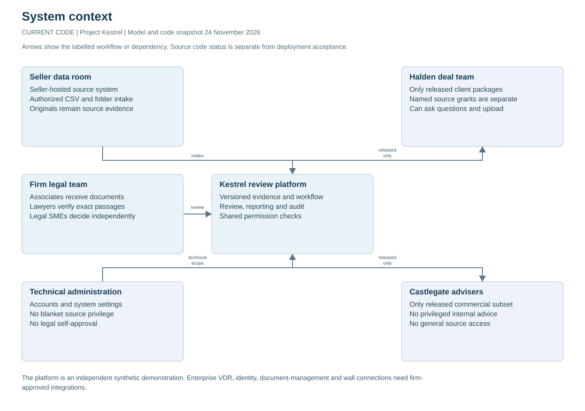

# System context

**CURRENT CODE.** The platform is an independent synthetic demonstration. Enterprise VDR, identity, document-management and wall connections need firm-approved integrations.

[PNG image](01_system_context.png) · [Editable Mermaid](01_system_context.mmd)

## Evidence

- `docs/01_design/00_SOURCE_AND_SCOPE.md`
- `backend/kestrel/services/auth.py`
