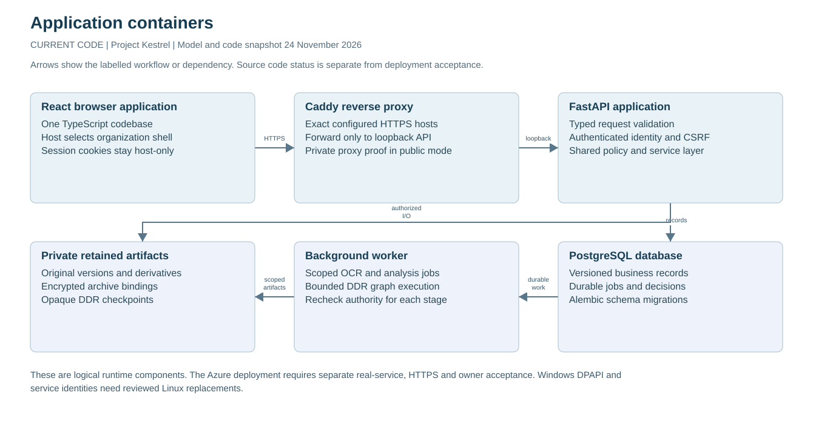

# Application containers

**CURRENT CODE.** These are logical runtime components. The Azure deployment requires separate real-service, HTTPS and owner acceptance. Windows DPAPI and service identities need reviewed Linux replacements.

[PNG image](02_application_containers.png) · [Editable Mermaid](02_application_containers.mmd)

## Evidence

- `backend/kestrel/main.py`
- `backend/kestrel/preview.py`
- `deployment/azure/services/README.md`
