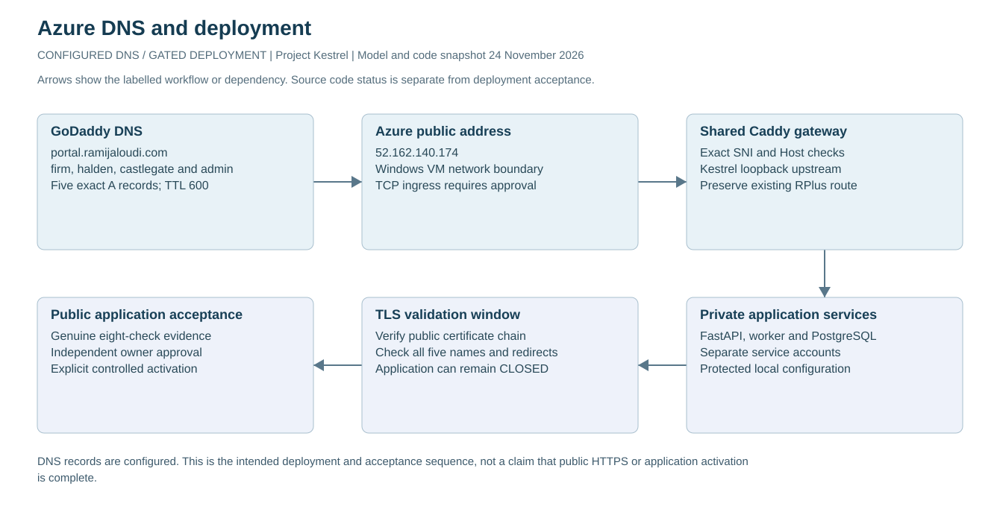

# Azure DNS and deployment

**CONFIGURED DNS / GATED DEPLOYMENT.** DNS records are configured. This is the intended deployment and acceptance sequence, not a claim that public HTTPS or application activation is complete.

[PNG image](03_azure_dns_and_deployment.png) · [Editable Mermaid](03_azure_dns_and_deployment.mmd)

## Evidence

- `deployment/azure/README.md`
- `backend/kestrel/deployment_settings.py`
