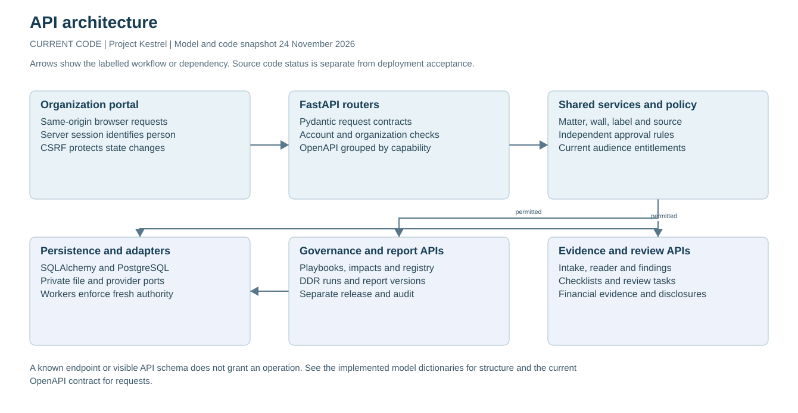

# API architecture

**CURRENT CODE.** A known endpoint or visible API schema does not grant an operation. See the implemented model dictionaries for structure and the current OpenAPI contract for requests.

[PNG image](04_api_architecture.png) · [Editable Mermaid](04_api_architecture.mmd)

## Evidence

- `backend/kestrel/main.py`
- `backend/kestrel/preview.py`
- `backend/kestrel/api`
