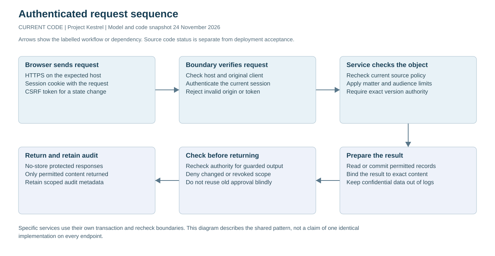

# Authenticated request sequence

**CURRENT CODE.** Specific services use their own transaction and recheck boundaries. This diagram describes the shared pattern, not a claim of one identical implementation on every endpoint.

[PNG image](05_authenticated_request_sequence.png) · [Editable Mermaid](05_authenticated_request_sequence.mmd)

## Evidence

- `backend/kestrel/services/auth.py`
- `backend/kestrel/public_boundary.py`
- `backend/kestrel/api/resource_assets.py`
