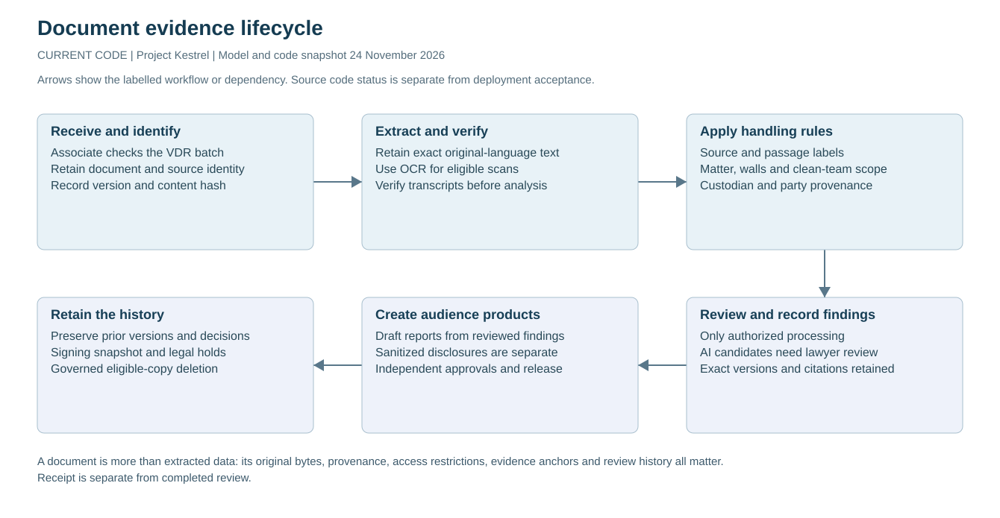

# Document evidence lifecycle

**CURRENT CODE.** A document is more than extracted data: its original bytes, provenance, access restrictions, evidence anchors and review history all matter. Receipt is separate from completed review.

[PNG image](06_document_evidence_lifecycle.png) · [Editable Mermaid](06_document_evidence_lifecycle.mmd)

## Evidence

- `backend/kestrel/models.py`
- `backend/kestrel/services/workflow.py`
- `backend/kestrel/services/disclosures.py`
