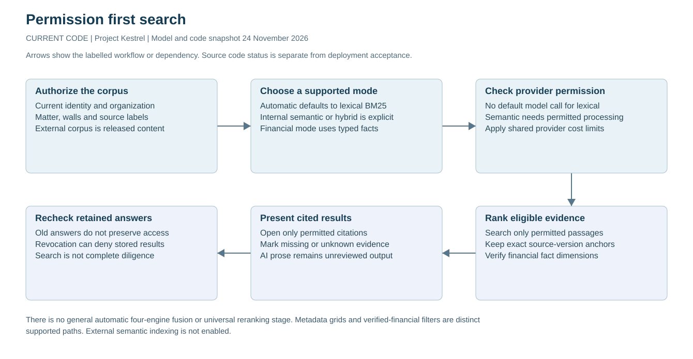

# Permission first search

**CURRENT CODE.** There is no general automatic four-engine fusion or universal reranking stage. Metadata grids and verified-financial filters are distinct supported paths. External semantic indexing is not enabled.

[PNG image](07_permission_first_search.png) · [Editable Mermaid](07_permission_first_search.mmd)

## Evidence

- `backend/kestrel/services/questions.py`
- `docs/02_workflows/60_PERMISSION_FIRST_RETRIEVAL.md`
