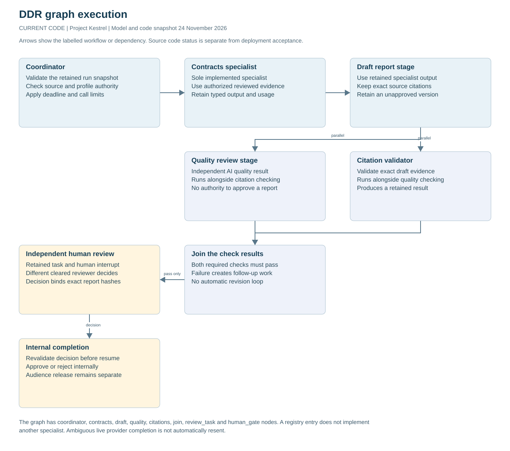

# DDR graph execution

**CURRENT CODE.** The graph has coordinator, contracts, draft, quality, citations, join, review_task and human_gate nodes. A registry entry does not implement another specialist. Ambiguous live provider completion is not automatically resent.

[PNG image](08_ddr_graph_execution.png) · [Editable Mermaid](08_ddr_graph_execution.mmd)

## Evidence

- `backend/kestrel/ddr/graph.py`
- `backend/kestrel/services/ddr_execution.py`
