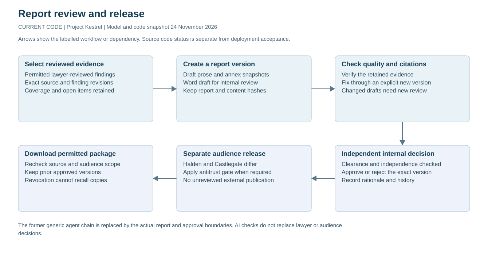

# Report review and release

**CURRENT CODE.** The former generic agent chain is replaced by the actual report and approval boundaries. AI checks do not replace lawyer or audience decisions.

[PNG image](09_report_review_and_release.png) · [Editable Mermaid](09_report_review_and_release.mmd)

## Evidence

- `backend/kestrel/services/reports.py`
- `backend/kestrel/services/ddr_runs.py`
