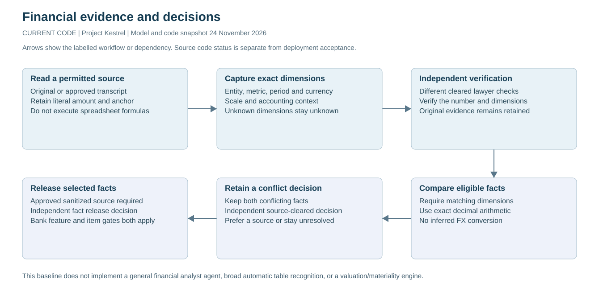

# Financial evidence and decisions

**CURRENT CODE.** This baseline does not implement a general financial analyst agent, broad automatic table recognition, or a valuation/materiality engine.

[PNG image](10_financial_evidence_and_decisions.png) · [Editable Mermaid](10_financial_evidence_and_decisions.mmd)

## Evidence

- `backend/kestrel/services/financial.py`
- `docs/02_workflows/76_FINANCIAL_CONTEXT_AND_STAGING.md`
