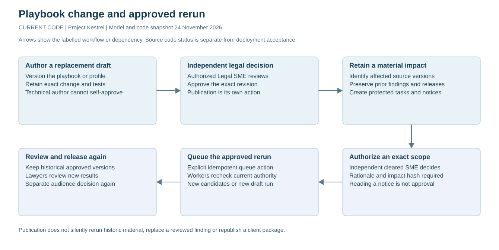

# Playbook change and approved rerun

**CURRENT CODE.** Publication does not silently rerun historic material, replace a reviewed finding or republish a client package.

[PNG image](11_playbook_change_and_approved_rerun.png) · [Editable Mermaid](11_playbook_change_and_approved_rerun.mmd)

## Evidence

- `backend/kestrel/services/action_center.py`
- `backend/kestrel/services/agent_registry.py`
