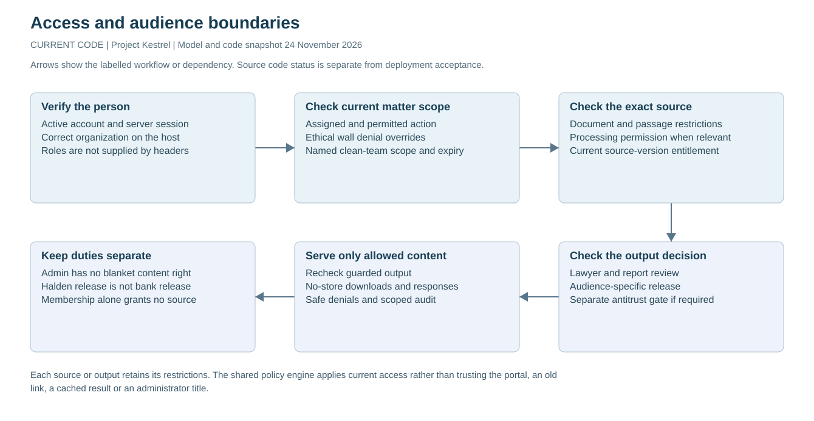

# Access and audience boundaries

**CURRENT CODE.** Each source or output retains its restrictions. The shared policy engine applies current access rather than trusting the portal, an old link, a cached result or an administrator title.

[PNG image](12_access_and_audience_boundaries.png) · [Editable Mermaid](12_access_and_audience_boundaries.mmd)

## Evidence

- `backend/kestrel/services/auth.py`
- `backend/kestrel/services/policy.py`
- `backend/kestrel/services/response_guard.py`
