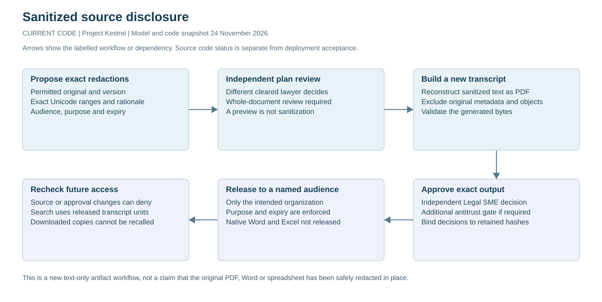

# Sanitized source disclosure

**CURRENT CODE.** This is a new text-only artifact workflow, not a claim that the original PDF, Word or spreadsheet has been safely redacted in place.

[PNG image](13_sanitized_source_disclosure.png) · [Editable Mermaid](13_sanitized_source_disclosure.mmd)

## Evidence

- `backend/kestrel/services/disclosures.py`
- `docs/02_workflows/59_VALIDATED_SANITIZED_DISCLOSURES.md`
