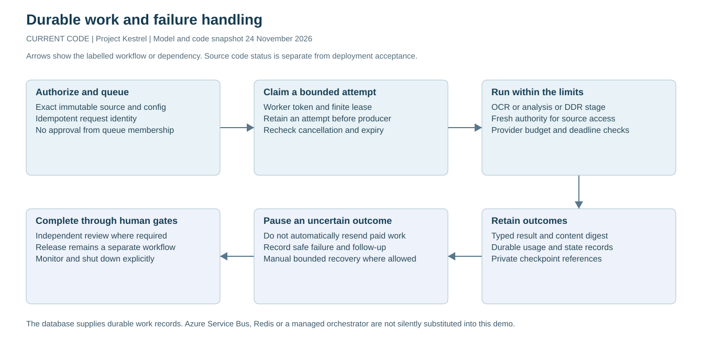

# Durable work and failure handling

**CURRENT CODE.** The database supplies durable work records. Azure Service Bus, Redis or a managed orchestrator are not silently substituted into this demo.

[PNG image](14_durable_work_and_failure_handling.png) · [Editable Mermaid](14_durable_work_and_failure_handling.mmd)

## Evidence

- `backend/kestrel/services/ddr_execution.py`
- `backend/kestrel/services/jobs.py`
