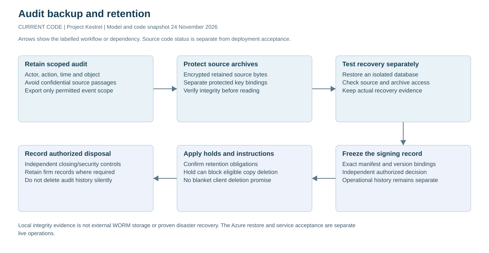

# Audit backup and retention

**CURRENT CODE.** Local integrity evidence is not external WORM storage or proven disaster recovery. The Azure restore and service acceptance are separate live operations.

[PNG image](15_audit_backup_and_retention.png) · [Editable Mermaid](15_audit_backup_and_retention.mmd)

## Evidence

- `backend/kestrel/services/archives.py`
- `backend/kestrel/services/lifecycle.py`
- `docs/04_operations/43_BACKUP_ARCHIVE_AND_VERIFICATION.md`
