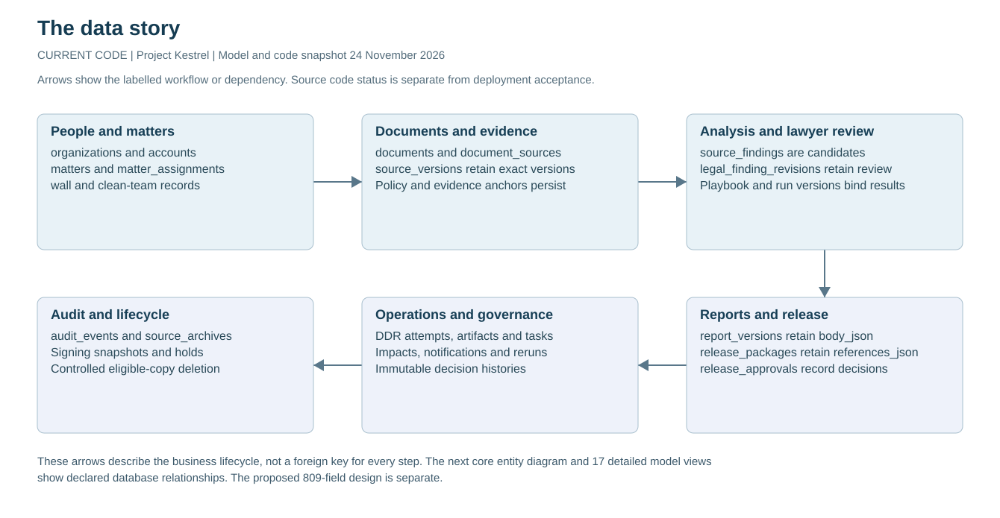

# The data story

**CURRENT CODE.** These arrows describe the business lifecycle, not a foreign key for every step. The next core entity diagram and 17 detailed model views show declared database relationships. The proposed 809-field design is separate.

[PNG image](16_the_data_story.png) · [Editable Mermaid](16_the_data_story.mmd)

## Evidence

- `backend/kestrel/models.py`
- `backend/kestrel/data/resource_library/Implemented_Schema_Fields.csv`
