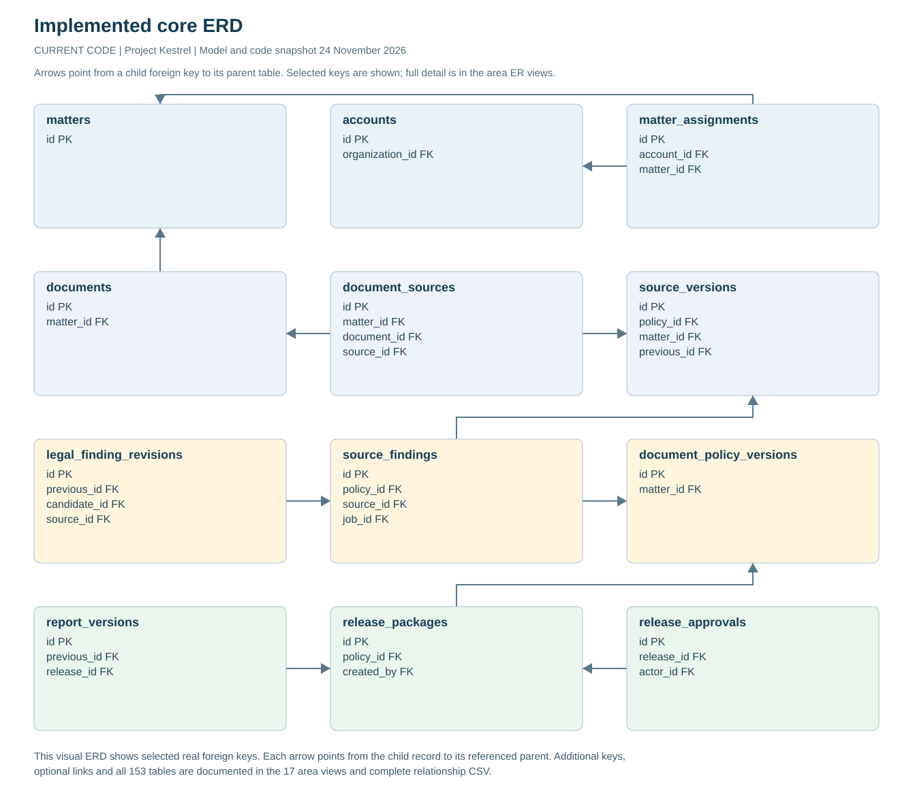

# Implemented core ERD

**CURRENT CODE.** This visual ERD shows selected real foreign keys. Each arrow points from the child record to its referenced parent. Additional keys, optional links and all 153 tables are documented in the 17 area views and complete relationship CSV.

[PNG image](17_implemented_core_erd.png) · [Editable Mermaid](17_implemented_core_erd.mmd)

## Evidence

- `backend/kestrel/models.py`
- `backend/kestrel/data/resource_library/Implemented_Schema_Fields.csv`
