# Identity And Access

Implemented model snapshot. This area owns 21 tables. Key-only parent tables provide cross-area context.

```mermaid
erDiagram
  account_role_grants {
    string account_id FK
    string role_id FK
    string id PK
  }
  accounts {
    string organization_id FK
    string id PK
  }
  administration_decisions {
    string matter_id FK
    string actor_id FK
    string target_id FK
    string id PK
  }
  classification_requests {
    string source_id FK
    string proposed_by FK
    string reviewer_id FK
    string id PK
  }
  clean_team_memberships {
    string account_id FK
    string matter_id FK
    string approved_by FK
    string id PK
  }
  clients {
    string created_by FK
    string id PK
  }
  ethical_walls {
    string account_id FK
    string matter_id FK
    string id PK
  }
  login_throttles {
    string key PK
  }
  matter_assignments {
    string account_id FK
    string matter_id FK
    string id PK
  }
  matter_validations {
    string matter_id PK, FK
    string client_id FK
  }
  matters {
    string id PK
  }
  organizations {
    string id PK
  }
  question_answers {
    string actor_id FK
    string matter_id FK
    string id PK
  }
  roles {
    string id PK
  }
  server_sessions {
    string account_id FK
    string id PK
  }
  service_clients {
    string account_id FK
    string id PK
  }
  service_tokens {
    string client_id FK
    string id PK
  }
  source_access_grants {
    string source_id FK
    string account_id FK
    string proposed_by FK
    string approved_by FK
    string revoked_by FK
    string id PK
  }
  source_versions {
    string id PK
  }
  wall_check_records {
    string actor_id FK
    string subject_id FK
    string client_id FK
    string matter_id FK
    string id PK
  }
  wall_control_decisions {
    string control_id PK, FK
    string actor_id FK
  }
  wall_controls {
    string client_id FK
    string matter_id FK
    string account_id FK
    string proposed_by FK
    string retire_id FK
    string id PK
  }
  accounts ||..o{ account_role_grants : "account_id"
  roles ||..o{ account_role_grants : "role_id"
  organizations ||..o{ accounts : "organization_id"
  matters ||..o{ administration_decisions : "matter_id"
  accounts ||..o{ administration_decisions : "actor_id"
  accounts |o..o{ administration_decisions : "target_id"
  source_versions ||..o{ classification_requests : "source_id"
  accounts ||..o{ classification_requests : "proposed_by"
  accounts |o..o{ classification_requests : "reviewer_id"
  accounts ||..o{ clean_team_memberships : "account_id"
  matters ||..o{ clean_team_memberships : "matter_id"
  accounts ||..o{ clean_team_memberships : "approved_by"
  accounts ||..o{ clients : "created_by"
  accounts ||..o{ ethical_walls : "account_id"
  matters ||..o{ ethical_walls : "matter_id"
  accounts ||..o{ matter_assignments : "account_id"
  matters ||..o{ matter_assignments : "matter_id"
  matters ||--o| matter_validations : "matter_id"
  clients ||..o{ matter_validations : "client_id"
  accounts ||..o{ question_answers : "actor_id"
  matters ||..o{ question_answers : "matter_id"
  accounts ||..o{ server_sessions : "account_id"
  accounts ||..o{ service_clients : "account_id"
  service_clients ||..o{ service_tokens : "client_id"
  source_versions ||..o{ source_access_grants : "source_id"
  accounts ||..o{ source_access_grants : "account_id"
  accounts ||..o{ source_access_grants : "proposed_by"
  accounts |o..o{ source_access_grants : "approved_by"
  accounts |o..o{ source_access_grants : "revoked_by"
  accounts ||..o{ wall_check_records : "actor_id"
  accounts |o..o{ wall_check_records : "subject_id"
  clients ||..o{ wall_check_records : "client_id"
  matters |o..o{ wall_check_records : "matter_id"
  wall_controls ||--o| wall_control_decisions : "control_id"
  accounts ||..o{ wall_control_decisions : "actor_id"
  clients ||..o{ wall_controls : "client_id"
  matters |o..o{ wall_controls : "matter_id"
  accounts |o..o{ wall_controls : "account_id"
  accounts ||..o{ wall_controls : "proposed_by"
  wall_controls |o..o{ wall_controls : "retire_id"
```

[Editable Mermaid](01_identity_and_access.mmd) · [All data views](../README.md)
