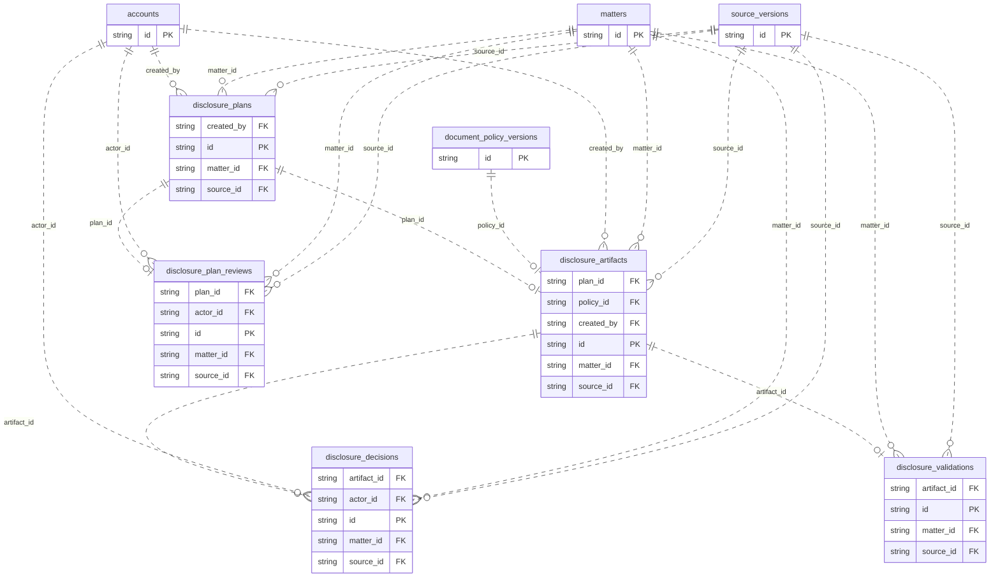

# Sanitized Disclosures

Implemented model snapshot. This area owns 5 tables. Key-only parent tables provide cross-area context.

[Editable Mermaid](06_sanitized_disclosures.mmd) · [All data views](../README.md)
