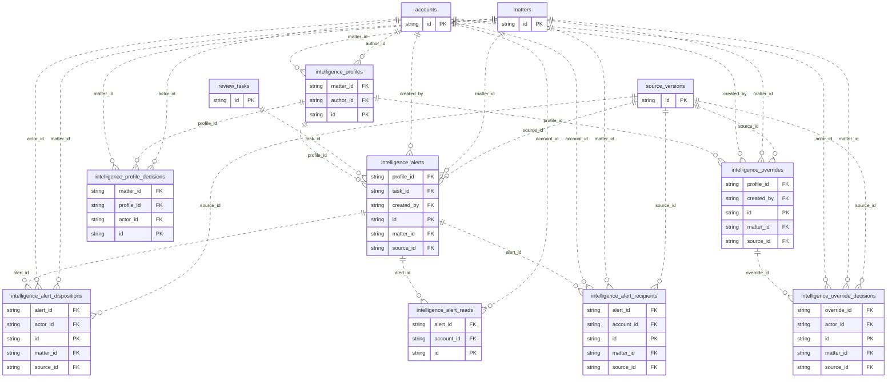

# Review Intelligence

Implemented model snapshot. This area owns 8 tables. Key-only parent tables provide cross-area context.

[Editable Mermaid](10_review_intelligence.mmd) · [All data views](../README.md)
