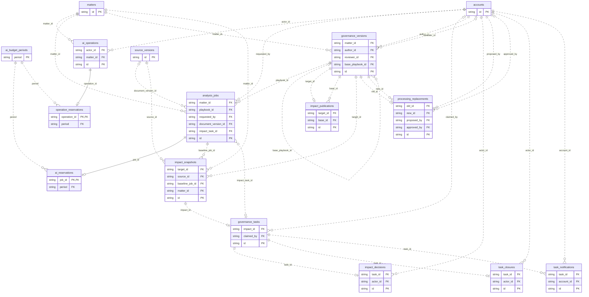

# Governance And Analysis

Implemented model snapshot. This area owns 13 tables. Key-only parent tables provide cross-area context.

[Editable Mermaid](15_governance_and_analysis.mmd) · [All data views](../README.md)
