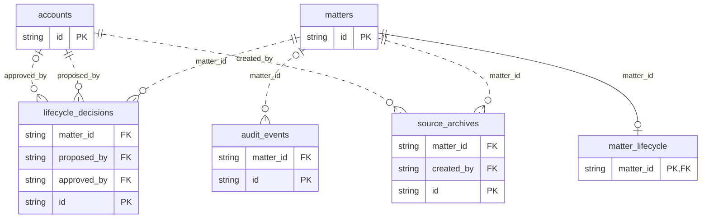

# Lifecycle And Audit

Implemented model snapshot. This area owns 4 tables. Key-only parent tables provide cross-area context.

[Editable Mermaid](17_lifecycle_and_audit.mmd) · [All data views](../README.md)
