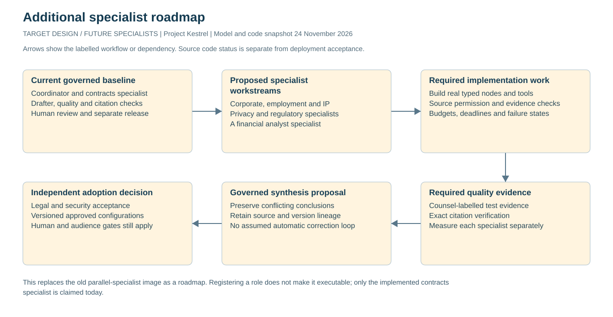

# Additional specialist roadmap

**TARGET DESIGN / FUTURE SPECIALISTS.** This replaces the old parallel-specialist image as a roadmap. Registering a role does not make it executable; only the implemented contracts specialist is claimed today.

[PNG image](20_additional_specialist_roadmap.png) · [Editable Mermaid](20_additional_specialist_roadmap.mmd)

## Evidence

- `backend/kestrel/ddr/graph.py`
- `docs/05_validation/80_GATE_ACCEPTANCE_STATUS.md`
