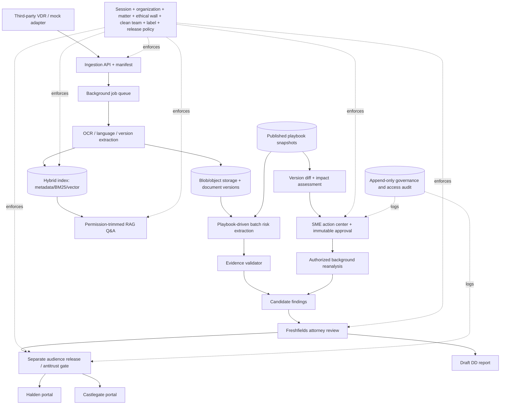

# 03 — High-level architecture (HLD)

## Logical boundaries
- **Presentation:** one React codebase, host-selected firm/client/bank shell, same-origin HTTPS `/api`. Firm shell includes admin/playbook screen, Legal SME Action Center, attorney review, release desk, clean-team access where authorized. Client and bank only see released artifacts scoped to audience and exclusions.
- **Application:** FastAPI routers + services for identity, policy, documents, playbooks, impacts, reviews, releases, notifications, AI, reporting, audits, legal research, incidents.
- **Persistence:** PostgreSQL (production/design target); versioned object storage with signed short-lived download access gated by API; separate search indexes/materialized visibility. SQLite allowed only initial isolated development tests.
- **Asynchronous:** durable jobs with idempotency, retries, dead-letter, concurrency caps, event outbox, scoped worker principals. Production concept Azure Service Bus/approved Azure; local mock in tests.
- **AI adapters:** deterministic fixture mode (free), approved enterprise multilingual provider (firm target only). Never send unauthorized chunks to model. Never assume fine-tuning required.
- **Integrations:** `VDRConnector`, `DMSAdapter`, `WallsProvider`, `CollaborationAdapter`, `IdentityProvider`, `SearchProvider`, `ModelProvider`, `OCRProvider` interfaces. Demo uses mocks; firm target may bind to its approved services.

## Environments
- `LOCAL`: Windows bind localhost, fake/fixture integrations, no external access. Protected APIs deny until real authentication implemented.
- `PUBLIC_DEMO`: isolated and explicitly authorized synthetic deployment, strong account security, HTTPS, host-only cookies, no dev headers, no actual firm data/marks, edge and application rate-limits, cost controls.
- `FIRM_TARGET_DESIGN`: Freshfields-controlled EU Azure/M365/iManage/Intapp with enterprise approvals; do not claim this is deployed.

## Why FastAPI
Python ecosystem for OCR/AI, typed Pydantic schemas, async web IO, generated OpenAPI, dependency injection. CPU OCR and batch AI must run in **workers**, not FastAPI event loop. Django is viable if large built-in admin/business workflow needs outweigh FastAPI benefits; FastAPI + dedicated React chosen to demonstrate explicit API/policy design.
