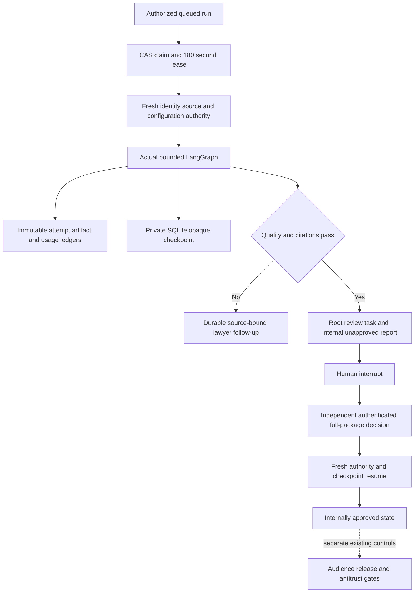

# 74 Durable internal DDR graph execution

24 November 2026. This is the application bridge for the actual LangGraph foundation in document 72. It uses the reviewed run/evidence/approval services and immutable DDR models from migration 0036. It adds **no model/migration columns**, no release tool and no permission-management tool.

## Execution and human boundary

`services/ddr_execution.py` implements `DurableGraphPorts` and `run_once(sessions, heartbeat=None, checkpoint_root=None, provider_factory=None) -> bool`. The console worker invokes OCR, then DDR, then the existing analysis worker. A queue iteration starts no external process or paid model call by itself.

The default provider is the explicit offline `FakeProvider`. Its claims copy reviewed fixture findings and exact citations, and its token counts are **simulated accounting values**, not measured API usage or legal-quality evidence. Both an `openai` run and a provider with `live=True` are refused by this bridge. The root run-creation service also blocks live processing. There were no paid model calls in this task.

The injected provider-factory contract is `provider_factory(run_config: dict) -> Provider`. Configuration includes pinned approved agent definitions. Offline prompts are retained governance configuration and deliberately do not change the deterministic fake's behavior. A later stage-aware live factory must consume the approved stage prompt/model/timeout/pricing under an explicitly authorized activation; it must not infer a provider/key from ambient environment variables. This bridge does not claim that the future live aggregate-budget adapter has been activated.

## Fresh authority and limits

Each graph-port callback uses a fresh database session, including parallel quality/citation branches. It rederives the authenticated run requester through `ddr_runs.execution_authority`, verifies current matter/wall/clean-team/source/OCR/processing/playbook/profile authority, compares the full server-derived `RunSpec`, and requires **state running, the exact current worker token and an unexpired lease**. Before returning a prepared artifact, evidence bundle, task or approval, authority is checked again. A cancelled/completed worker cannot continue merely because it still knows a run ID.

Effective limits are the minimum of the immutable run configuration and every selected approved agent profile: concurrency, call count, total/output token bounds and cost bound. The graph foundation imposes its own bounded recursion and 120-second active execution allowance. The claim lease is 180 seconds. Callback heartbeats keep the existing process monitor responsive; human pause does not hold a worker lease.

Worker claiming uses a row lock/CAS over current state and lease. A stale worker token cannot persist a result. An active execution cycle allows at most **two claims**; a third fails with `WORKER_RETRY_LIMIT` before a producer executes. An authenticated human-decision acknowledgement begins a new bounded active cycle, so a prior safe crash recovery cannot prevent legitimate independent review resumption. This does not reset immutable node attempts or permit another paid attempt.

## Durable attempt result and usage records

Before any producer runs, an immutable `DDRAttempt` is committed with run, step, input hash and config hash. A completed identical step returns the same immutable artifact reference. Changed input/config fails. A committed attempt without a corresponding result is ambiguous: the run enters `paused_ambiguous` and no automatic resend occurs, including after process restart.

Provider callbacks do not hold a database transaction or lock. After completion, fresh authority is required before atomically writing the typed `DDRArtifact` and `DDRNodeResult`. Artifact payloads/hashes, input/output tokens and cost are retained separately from checkpoint state. The node ledger contains three provider results plus the deterministic citation result, whose usage is zero. Invalid types, output bounds, usage, altered artifact hashes or lost authority fail closed.

Each offline provider step also has a durable `AIOperation` and **zero-cent** `OperationReservation` in the shared application ledger. It neither reserves $2 nor consumes the $10 monthly paid allowance. The offline graph remains usable when the paid allowance is already exhausted. The aggregate call/token checks include completed actual/simulated usage plus conservative pending token reservations. Unknown completion retains its reservation rather than pretending to settle it.

The configured run cost ceiling remains at most $2; the shared application monthly ceiling is $10 in the existing AI-budget service. The live adapter and single aggregate reservation are implemented in the addendum below. Root's explicit integration constant controls create/execution activation independently; no paid calls were used to validate this bridge.

## Checkpoint privacy and recovery

The application database is authoritative for evidence, artifacts, attempts, usage, tasks and decisions. Actual `SqliteSaver` checkpoints live under a private per-run UUID directory in `.runtime/ddr-checkpoints`, or an injected isolated test directory. Directory resolution must remain within the selected checkpoint root. On Windows, a protected DACL grants the current worker SID and SYSTEM access to the directory, database and existing SQLite sidecars before use. On POSIX the directory/file modes are 0700/0600. No checkpoint filename or thread ID is an API entitlement.

Checkpoints contain the immutable server run specification, opaque IDs/references, hashes and phase. Source passages, summaries, draft prose, prompts and provider exceptions stay outside checkpoint state. Callback failures are converted to fixed error codes before they can be persisted by the graph. The checkpointer has no public read/download API.

A process crash after an artifact commit but before its graph checkpoint can safely recover: the reclaimed worker repeats the graph node, while `execute_once` returns the already committed result without calling the producer. A process crash with an incomplete attempt pauses for reconciliation instead. No automatic provider retry/failover is introduced.

Root `ddr_runs.review_task` atomically creates/reuses the review task, an **internal unapproved ReportVersion** and its DDR link. The port commits that authorized transaction, then the graph interrupts. Root `approval` rereads the authenticated independent decision, exact complete report hash, draft/config/snapshot hashes and current reviewer/source authority. A browser acknowledgement or graph state cannot create approval. After a valid receipt the worker marks internal completion; it creates no second report and performs no audience publication. Manually edited report versions use root's new human task/approval workflow rather than resuming an obsolete graph draft.

If quality/citation validation fails, the worker creates an idempotent existing `ReviewTask` per authorized source, assigned to the requester with a fixed follow-up rationale. It records no report approval and changes no finding. Task keys bind run and source snapshot, so follow-up does not multiply on recovery.

## Verification actually run

- Initial durable bridge suite: **7 passed in 77.74 seconds**.
- Final isolated PostgreSQL bridge suite: **9 passed in 51.96 seconds**.
- Combined SQLite execution, pure graph and durable run-service suites: **34 passed in 71.46 seconds**.
- After the bounded-claim change: third-claim refusal plus legitimate human-cycle resume **2 passed in 28.89 seconds**. No other bridge behavior changed.
- Python compile checks passed for the bridge and console hook.

Coverage includes actual SQLite close/reopen and pending human interrupt; independent full-package approval with no external release; exact four-node result/three-provider usage accounting; opaque checkpoint canaries; unknown completion persisted without resend; requester wall revocation after provider completion; stale worker token; a live provider injected into an offline run refused before invocation; hard process crash after a committed contracts artifact followed by only draft/quality producer calls; quality-failure follow-up; offline operation at an already-exhausted monthly paid allowance; and minimum approved profile bounds.

Tests use synthetic fixtures and temporary PostgreSQL schemas. No live application migration, data transfer, approval replay, provider credential inspection, cloud resource or public deployment occurred. Production Windows service restart and the full final cross-domain matrix remain root integration checks; these focused results do not assert production readiness or legal accuracy.

## November 24 live-provider and aggregate-budget addendum

`adapters/ddr_provider.py` exposes `pricing_manifest()`, `manifest(config)`, `validate_config(config)`, `availability()` and `factory(config) -> Provider`. The root run configuration must contain exactly one independently tested, approved, published OpenAI profile for contracts, drafter and quality. The manifest binds their version/content/definition hashes, the fixed endpoint and prices. Registry and whole-config hashes use the registry's ASCII canonicalization, including German prompts; graph messages and artifact hashes retain graph canonicalization. Existing service authority checks revalidate publication, reviewer role, retained source scope, exact evidence/configuration and external-processing permission before and after every callback. Profile tool manifests constrain implemented internal stages; the model receives no executable tools and cannot approve or release anything.

The adapter consumes each stage's actual published prompt, pinned model, timeout and output bound. Before reservation/send, an optional graph hook obtains a conservative UTF-8 byte bound over both system messages, input and structured-output schema, with protocol overhead. The minimum approved run/profile token, call, concurrency, output and cost ceilings remain enforced. Oversized context is refused; it is not silently truncated.

The known manifest pins `gpt-5.4-mini-2026-03-17`, standard global text pricing of **$0.75 input / $4.50 output per million tokens**, checked November 24, 2026. Cached-input discounts are ignored, and each known node charge rounds up to a whole cent. Aggregate settlement sums those conservative node charges; this is an application estimate, not an account-wide billing limit. See the [official model specification and prices](https://developers.openai.com/api/docs/models/gpt-5.4-mini) and [saved factual receipt](../05_validation/evidence/74_openai_graph_pricing_2026-11-24.json).

Only the enabled Windows CurrentUser DPAPI setting supplies the key. No environment key, URL, organization/project, proxy or tracing fallback is used. Explicit sync SDK/HTTP clients restrict requests to `https://api.openai.com/v1/chat/completions`, disable redirects and all transport/SDK retries, enforce bounded responses and timeouts, and set `store=false`. Provider debug logs are suppressed in the call context, including when ambient SDK debug logging is enabled. Exceptions become fixed codes before checkpoint persistence. The OpenAI SDK normally retries some failures by default; this bridge explicitly sets zero as described in the [official SDK retry documentation](https://github.com/openai/openai-python#retries). `store=false` disables completion storage for the API feature; it does not assert a Zero Data Retention account arrangement or eliminate provider abuse-monitoring retention. See [OpenAI data controls](https://developers.openai.com/api/docs/guides/your-data).

Before the first paid node, a single `AIOperation(kind=ddr_aggregate)` and `OperationReservation` reserve the approved whole-run cap, at most **200 cents**, atomically against the shared **1000-cent New York monthly** allowance. Per-node operations and immutable results retain deduplication, actual input/output tokens and independently recomputed known cost; they do not reserve another $2. Pending token/cost estimates plus completed usage must fit the minimum profile ceilings before each send. When all three provider results are durably known and agree with the node ledger, one idempotent settlement charges their sum and releases the unused reservation. Completed-node recovery and independent human resume reuse the same result/aggregate and cause no new provider call or charge.

Unknown completion, missing/invalid usage, changed model, malformed/oversized output, usage/cost mismatch or authority loss pauses without automatic resend; the whole unsettled aggregate stays reserved. Known prior node usage remains durable. There is no operator reconciliation/retry UI in this slice; a paused ambiguous run requires a separate authorized reconciliation decision and must not be manually requeued as a retry. Offline mode continues to create only zero-cent node reservations and works at an exhausted paid allowance.

Worker claims allow at most two attempts per active execution cycle. A legitimate recorded human decision begins a new bounded cycle. Third-claim refusal writes sanitized audit metadata. If signing freezes mid-callback, retained graph writes remain closed; operational lease cleanup and sanitized `AuditEvent` evidence complete without adding a forbidden retained `DDREvent` or changing frozen source/report content.

Verification before root activation:

- Original offline/durable suite: **10 passed in 33.96 seconds**.
- Expanded SQLite provider/execution matrix: **31 passed in 69.59 seconds**.
- PostgreSQL provider, aggregate-budget and durable execution matrix, including actual published German prompts: **32 passed in 78.40 seconds**.
- Combined SQLite provider, execution, pure graph and durable run services: **57 passed in 100.30 seconds**.
- After final manifest bindings: **10 provider tests passed in 3.71 seconds**, and PostgreSQL German-prompt, third-claim and frozen-stop checks **3 passed in 14.92 seconds**.
- Default live factory through all three actual installed LangChain/OpenAI SDK stages, using mocked HTTP transport and real isolated PostgreSQL run/configuration/evidence services: **1 passed in 9.19 seconds**. It reached attorney interrupt, retained four immutable node results and settled one aggregate to the exact simulated 300 input / 300 output tokens and three conservative cents.
- Dependency verification: `pip check` reported **No broken requirements found**.

All SDK requests in tests use a mocked HTTP transport and a synthetic key; no paid requests or private credential inspection occurred. Root retains activation, final full-suite, live Windows restart and public-deployment gates.
