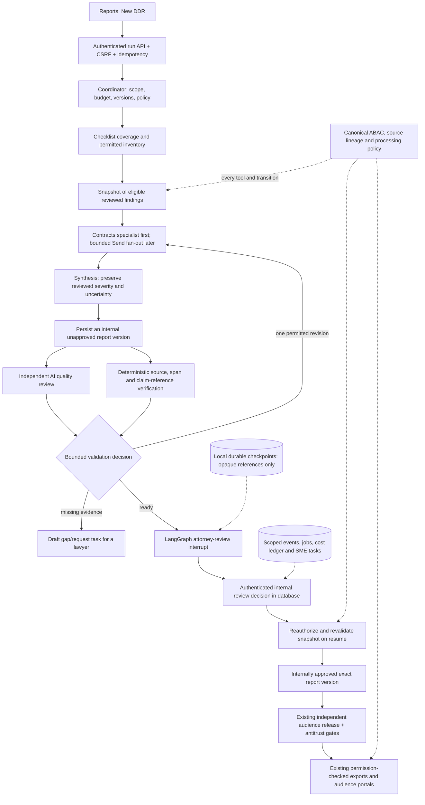

# 52 — LangGraph DDR engine: Phase 0 audit and Phase 1/2 plan

23 November 2026. [DESIGN] unless explicitly marked [EXISTING]. This is an incremental extension of the local synthetic Kestrel application, not a replacement or a production deployment.

## Package gate and work completed

[EXISTING] Read the supplied README, implementation prompt and taxonomy. Imported unchanged copies as docs/08_development/prompts/CODEX_IMPLEMENTATION_PROMPT.md and data/reference/CHECKLIST_TAXONOMY.json. Read the authoritative assessment, project instructions, design/security material and the actual policy, reporting, queue, budget and governance implementations. Ran the existing backend suite and frontend build; final results are recorded below.

The package explicitly says: **“Stop after Phase 0 to show the exact plan and first implementation batch unless the user explicitly authorizes coding.”** This delivery completes that review gate. No LangGraph application code, dependency installation, database migration, model call, release decision or deployment is part of Phase 0. Source-code implementation follows review of this plan.

## A. Source and repository findings

[EXISTING] The supplied source at C:/Freshfields-Takehome/Due_Diligence_Checklist/Contract-Content-Due-Diligence_Checklist.pdf is a 21-page Bloomberg Law document-request checklist. Page 1 describes information requests and conditional relevance; page 21 carries the 2023 copyright and footer code 0523. The package describes it as May 2023. It is not a completed DDR, a legal authority, an official Freshfields template or an SME-approved UK/German playbook. Extracted headings were checked across all 21 pages; pages 1 and 21 were also rendered and visually inspected. Source checksum and verified section starts are in data/reference/CHECKLIST_SOURCE_AUDIT.json. The proprietary PDF remains at its original location and has not been copied into the application, indexed or sent to a model.

| Section | Subject (short label) | PDF pages | Planned specialist |
|---|---|---|---|
| A | Corporate / ownership records | 1–3 | corporate |
| B | Financial / accounting records | 4 | financial_tax |
| C | Tax | 5–6 | financial_tax |
| D | Debt / obligations | 6–7 | financial_tax |
| E | Property / equipment | 8 | property |
| F | IP / software | 9 | ip_software |
| G | Material contracts | 10–11 | material_contracts |
| H | Operations | 12–13 | material_contracts / operations |
| I | Disputes | 13 | litigation |
| J | Regulation | 14 | regulatory_antitrust |
| K | Employment / compensation | 14–16 | employment |
| L | Privacy / security | 16–18 | privacy_security |
| M | ESG | 18–21 | esg |
| N | Matter-specific requests | 21 | custom |

The JSON contains section-level taxonomy, not item-level ChecklistItem records: item numbers, stable item IDs, source-version metadata, matter scope, owners, evidence links and approval records still need implementation. Metadata verification does not approve legal applicability. U.S.-specific requests remain conditional; absence never establishes N/A or noncompliance.

[BRIEF] The five-page assessment describes waves **over six weeks**, not a mandated six-wave count. The new package and some historical repository notes use “six-wave”; the brief controls. The target is a private German GmbH, not a listed target. The 12,000-document / 400,000-page volume is a planning forecast, not demonstrated local throughput. The real first wave still uses approved firm tooling; a new external-login app has a separate 4–6-week security review.

### Current implementation versus gaps

| [EXISTING] component | Reuse point | [TO BUILD] for DDR graph |
|---|---|---|
| FastAPI, server sessions, CSRF, OAuth scopes | api/auth.py, api/integrations.py | Protected run APIs; no client-supplied identity or raw thread access |
| Canonical document ABAC and lineage | services/policy.py, documents.py, repositories/identity.py, walls.py | A policy enforcement wrapper around every graph tool, checkpoint access and resume |
| Retained sources, extraction/OCR, exact spans | services/workflow.py, adapters/extraction.py | Typed evidence snapshots binding the reviewed finding revision and source/text hash |
| Reviewed findings and source-bound revisions | services/diligence.py | Read-only snapshot retrieval; newly detected issues go to a separate candidate/task path |
| Report versions, citations, comparisons, Word/PDF/Excel | services/reports.py, report_ai.py, adapters/report_export.py, ReportsWorkspace.tsx | Original DDR chapter structure and claim-to-evidence map; reuse saved report versions |
| Audience release and antitrust checks | workflow.package / release decision paths | Enforce distinct internal DDR approval before an existing release endpoint can publish a graph-produced draft |
| Durable analysis queue and worker | services/jobs.py, scripts/console_runner.py | A separate durable DDR run job type, preserving analysis/rerun semantics |
| Immutable published playbooks and SME Action Center | governance.py, action_center.py, existing outbox/tasks/notifications | Agent/prompt/checklist publication adapters and impact handling; not already supported by the current legal_playbook-only publication path |
| OpenAI via direct Responses API and Windows-protected key | adapters/openai_review.py, provider_secrets.py | LangChain ChatOpenAI provider adapter and structured schemas; keep legacy paths working |
| $2 request / $10 monthly application ledger | services/ai_budget.py | Aggregate run-level reservations and per-node usage; cannot reserve another $2 for every graph node |
| Signing, closing, audit and local protected backups | lifecycle.py, auditing.py, archives.py | Snapshot/resume integration and minimal run events; no graph-controlled deletion |

[EXISTING] No langgraph, langchain or langchain_openai package/import was found in the application environment or declared dependencies. No backend dependency lock exists. Existing report generation is not a LangGraph implementation. Existing report approval primarily concerns audience release; internal DDR approval must become a separate authoritative record. Current processing checks use local OTHER-region environment rules; they are not yet a provider/purpose/EU failover policy engine. Existing source lifecycle terms must be mapped, not renamed destructively.

## B. High-level architecture

Phase 2 stops with an internally reviewed version; its graph has **no external-release tool**. The release and export boxes show later integration through existing services, not authority delegated to an agent.

### Low-level nodes and transitions

| Node | Inputs / permitted work | Output / failure behavior |
|---|---|---|
| Coordinator | Authenticated requester, explicit intended audience, cutoff, published legal configuration, selected reviewed IDs | ReportPlan, policy/evidence snapshot hashes and a preflight budget; deny unavailable scope without revealing titles/counts |
| Coverage | Versioned agreed checklist scope and authorized inventory | Requested/received/reviewed/gap status within visible scope; never infer legal applicability or complete matter coverage |
| Retrieval | Current reviewed finding revisions, original source/version spans and approved playbooks | EvidenceRef records; quarantine/unverified OCR/stale sources pause the run |
| Contracts specialist | Only assigned evidence and approved prompt; no arbitrary tool selection | Typed SpecialistResult citing opaque evidence IDs, preserving conditions and approved severity |
| Other specialists (Phase 3) | A; B–D; E; F; G/H; I; J; K; L; M; N, selected by approved scope | Isolated inputs; finance numbers and jurisdictional questions remain counsel/finance review items; no access to sibling branches by default |
| Synthesis | Scoped specialist results | Deduplicated risk references and open questions; no edits to approved findings or severity |
| Drafter | Reviewed facts and validated evidence references | DraftReport in an existing candidate ReportVersion with fixed lineage and audience intent |
| AI reviewer | Separate approved reviewer prompt and permitted draft/evidence | QualityReview flags; not an independent human legal approval or proof of correctness |
| Citation verifier | Canonical source bytes/text hashes, version IDs, Unicode spans and claim references | CitationValidation; incorrect quote/page/source or unsupported claim blocks readiness |
| Human gate | Opaque task/draft references only | interrupt; resume only after reading an authenticated database ReportApproval for the exact hash |
| Persistence / export | Rechecked actor, source state, snapshot and decision records | One idempotent saved version; return to the existing audience approval workflow |

Exact span validation proves source integrity, not semantic entailment. Claims must identify reviewed finding references; the reviewer flags apparent unsupported reasoning, and a lawyer remains responsible for interpretation. German source text stays original; any translation is a separately marked derivative and cannot replace the original pinpoint.

### Tools and authorization

A server-owned ToolContext binds run_id, requester identity, effective service capability, matter, intended audience, purpose, legal/config versions and deadline. Model arguments never establish the actor. Each read derives current principal/assignments/walls and uses policy.require plus current source lineage checks; model calls also use processing policy. Each write rechecks inside its transaction. Runs/checkpoints are not readable just because someone knows a LangGraph thread ID.

Read-only tools: validate_matter_and_actor; authorize_resource_action; resolve_effective_doc_attributes; get_checklist_item; list_checklist_gaps; get_approved_playbook; get_approved_findings; get_source_passages; validate_citation; get_report_snapshot. All return typed, scope-limited results. A legal-authorities tool returns verified registry references only, not an arbitrary web browser.

Write tools: write_report_draft_version and create_attorney_review_task operate through existing versioned persistence and task services with deduplication. Audit is metadata-only. Export delegates to the existing authorized renderer and rechecks access after rendering. Agents receive no shell, arbitrary Python, external browsing, permission-management, release, reanalysis-approval or records-deletion tools.

[DEMO] An execution capability records both the real requester and restricted worker service identity; it is server-issued, revocable, purpose-bound and short-lived. The worker re-derives the requester's current rights, never assumes root access. A prototype using requester-only execution must be explicitly labelled until the service-capability boundary is implemented.

### Typed models and storage

New schemas/ddr.py: ChecklistItem, ChecklistCoverage, ReportPlan, SpecialistAssignment, EvidenceRef, SpecialistResult, RiskSummary, ReportSection, DraftReport, CitationValidation, QualityReview, ReportApproval and ReportRun. Forbid unknown identity/approval fields in request bodies. Human approval states are never accepted from model output.

EvidenceRef binds source version, bytes_hash, text_hash, locator/unit, Unicode start/end, quote_hash, original language, OCR verification reference, reviewed finding revision, playbook version and governing-law metadata. Original excerpts/draft prose reside in the access-controlled evidence/report store. No raw passages or model conversation messages in graph checkpoints, ordinary audit or errors.

Proposed migrations (current head 0024):
- **0025:** checklist source/version/item and matter-scoped coverage/decision/evidence-link records; legal prompt/config references. Immutable published versions; append-only coverage/N/A decisions; only independently authorized human N/A with rationale.
- **0026:** DDR runs, approved evidence snapshots/items, restricted service capabilities, node attempts/cost subledger, draft/report links, internal approval records, candidate issue/task links and durable run outbox. Unique requester/idempotency, run/node/input hash and run/report snapshot constraints prevent duplicate output.
- Local checkpointer schema/version is explicit and tested. Demo-only durable SQLite checkpoints may hold opaque references under .runtime with application authorization; tests may use an in-memory saver. A shared production PostgreSQL saver is a later firm-approved adapter. Do not present an in-memory saver as restartable or private SQLite as production durability.

Graph state contains run_id, matter_id, requester_id, requested_audience, report_kind, cutoff, snapshot/checklist IDs, published playbook/prompt map, graph/model configuration hashes, policy revision, opaque authorized references, assignment/result object references, gap/error codes, task/draft references, review iteration/limit, budget/deadline/status and correlation ID. Restricted IDs are themselves protected metadata. Store prose, sources and detailed quality reports outside checkpoint state. Bind the thread internally to the run; expose no generic state/update/resume endpoint.

### Retry, interruption and costs

[DESIGN] One contracts specialist in Phase 2; at most one correction iteration, explicit recursion/deadline limits and no unbounded loops. Later fan-out defaults to concurrency two with an approved maximum. Deterministic transient operations may retry with a small bounded policy; paid model calls have SDK/LangChain retries disabled. Unknown usage or ambiguous provider completion retains reservation and pauses for reconciliation; a graph resume must not resend it.

One aggregate $2 run ceiling shares the existing $10 monthly ledger across legacy calls and graph runs. Reserve atomically before fan-out; apportion remaining token/cost ceilings per node and reconcile actual usage without double charging. Pin pricing/configuration per model; unknown model price refuses live execution. Provider timeouts and failed attempts remain auditable. Never claim this application ledger caps other tools on the OpenAI account.

Review interrupt carries only task/run references. The resume payload is acknowledgement, never proof of legal approval. Read the independently recorded approval again, reauthorize and compare all input hashes after every pause/provider response and before persistence/export. Revocation/cancellation invalidates execution and blocks late commits. Source/config changes mark the run stale; human-authorized new snapshot/restart is distinct from silent reanalysis. Pinned graph versions are retained so old checkpoints are not resumed using changed node code without migration.

LangGraph can rerun interrupted node bodies, so separate irreversible writes/model invocations into idempotent attempt records before the gate and never wrap graph interrupts in a broad exception handler. Official references: [interrupts and replay](https://docs.langchain.com/oss/python/langgraph/interrupts), [persistence](https://docs.langchain.com/oss/python/langgraph/persistence), [Graph API](https://docs.langchain.com/oss/python/langgraph/graph-api). LangChain's [ChatOpenAI adapter](https://docs.langchain.com/oss/python/integrations/chat/openai) supplies typed structured output; it does not supply Kestrel authorization.

### API/UI integration

Use one new /api/v1/ddr router and Swagger group, not duplicate report/auth/release controllers. Planned routes: POST/GET /matters/{matter_id}/runs; GET /runs/{id}; POST cancel and request-review; GET coverage/evidence/draft/versions; POST review-decision. Export paths delegate to existing reports downloads and their policy checks. No external user starts or reads internal DDR runs. Existing /reports generation remains available.

Internal approval is a new exact-version decision separate from ReleaseApproval. Existing release endpoints must check it whenever a report belongs to a DDR run, so direct calls to the old endpoint cannot bypass the new gate. For graph reports, candidate DOCX is clearly marked draft; PDF rules follow the approved graph-report lifecycle rather than inheriting permissive legacy draft behavior accidentally.

Reports adds New DDR, run progress and review detail; DD Checklist Coverage shows only permitted scope; the existing source reader and report version editor remain. Root Admin technical agent settings and Legal SME prompt approval extend the existing governance UX without granting content access. New material legal prompt/checklist/tool-rule publications use the SME outbox/task/impact pattern; the current playbook-specific implementation needs explicit adapters and tests. Do not pretend a generic Agent Registry already exists.

## C. Ordered implementation batches and acceptance

| Batch | Proposed files | Exit criteria |
|---|---|---|
| P1.1 Domain / taxonomy | schemas/ddr.py; services/checklists.py; repositories/checklists.py; migrations/0025_ddr_foundation.py; models.py; tests/test_ddr_checklists.py | Stable A–N IDs/pages; one original G request abstraction; no copyrighted bulk text; missing evidence becomes a gap; no automatic N/A; exact independent legal version approval |
| P1.2 Evidence / tools | services/ddr_evidence.py; ddr/tools.py; ddr/context.py; ddr/provider_policy.py; tests/test_ddr_evidence.py, test_ddr_tools.py | Only reviewed version-specific evidence; exact offsets/hashes; wrong matter/wall/clean-team/bank/AI_RESTRICTED denials; scoped metadata and no prompt leakage |
| P1.3 Durable run foundation | migrations/0026_ddr_runs.py; models.py; services/ddr_runs.py; repositories/ddr_runs.py; ddr/schemas.py; services/ai_budget.py; tests/test_ddr_runs.py | Idempotency, aggregate reservation, cancellation, deadlines, capability expiry, stale snapshot and duplicate attempt rejection |
| P2.1 Framework / providers | backend/pyproject.toml; requirements-ddr.lock; ddr/providers/base.py, openai.py, fake.py; ddr/graph.py; ddr/nodes.py; ddr/checkpoints.py; tests/test_ddr_graph.py | Real StateGraph with fake typed chat model; coordinator → one contracts specialist → draft → quality/verifier → human interrupt; checkpoint survives restart; no duplicate reports/model calls on replay |
| P2.2 Human/API slice | api/ddr.py; main.py; preview.py; existing reports/workflow/action-center services; tests/test_ddr_api.py, test_ddr_approval.py | Session/CSRF; no actor spoof; authenticated independent internal decision; no graph-forged approval; old release endpoint cannot bypass DDR gate; external run and export denial |
| P2.3 Minimal portal / controlled OpenAI proof | DDRRunWorkspace.tsx; ReportsWorkspace.tsx; Resources; console_runner.py; Start/Stop; scripts/verify_ddr_run.py; tests/test_ddr_exports.py | Real transitions, exact customer-CoC citation, correction/reject/approval gate, usable source links; live synthetic OpenAI run only with approved configuration and available budget, exact spend reported; no external release |

Phase 1/2 pins a compatible LangGraph/langchain-core/langchain-openai/checkpointer dependency set and complete lock after resolution in an isolated environment, followed by existing regression tests. No versions are fabricated or claimed installed in this audit. Optional Azure, Vertex/Gemini and Ollama adapters are interfaces until individually configured/tested; no automatic provider failover. Disable external tracing/prompt telemetry by default.

First implementation batch is **P1.1 only**, with tests before schema/service changes and no public deployment. Registry rows are drafts, not published legal advice. Phase 2 cannot run live substantive prompts until independent legal configuration approval exists. Fake-model tests do not substitute for that decision.

Phases 3–5 expand the specialist matrix with LangGraph Send, full gap/action registers, technical and legal agent registries, richer DDR chapters/editor/export, evaluated multilingual quality and production hardening. Parallelism belongs to the application graph; it is not authorization to delegate this coding task to additional agents.

## D. Five principal risks and controls

1. **Delegation / identity laundering:** a tool or checkpoint thread might act with worker-wide privileges. Use server-derived requester + least-privilege capability, per-tool checks, private checkpoints and execution-time reauthorization. Fail closed on invalid policy/service scope.
2. **Clean-team inference leakage:** counts, titles, gaps, logs or sibling agent results may reveal restricted information. Separate snapshots/branches, return only authorized metadata and do not infer complete-matter coverage from a filtered view.
3. **Derivative restriction loss:** ordinary-looking prose can contain restricted pricing or privilege. Link every draft/report/evidence object to source policies; inherit the union of restrictions; no bank privileged lineage or ordinary client clean-team release without the separate authorized sanitization/antitrust workflow.
4. **Plausible but unsupported citations:** exact text can still fail to support a drafted assertion. Validate source/version/span deterministically, constrain claims to reviewed finding references, run separate quality review and require attorney judgment. New issues remain unapproved candidates.
5. **Technical approval mistaken for legal authority:** admin configuration, graph state, AI review or a resume token could be treated as approval. Keep technical configuration, substantive legal publication, internal report approval, reanalysis authorization and audience/antitrust release as distinct immutable human decisions with no self-approval.

Additional boundaries: source PDF licensing/distribution remains unresolved; section taxonomy is not a complete item registry; current legal applicability needs real SMEs; the personal OpenAI demo endpoint is not an approved EU enterprise deployment; Windows protected storage is not WORM; no production throughput or semantic-retrieval quality is established.

## E. Original fictional DDR outline

1. Cover, intended audience, report/version/cutoff and confidentiality labels.
2. Executive summary for partner/board, material risks and priority customer-contract exposures.
3. Transaction context, scope, methodology, reviewed-source coverage and VDR cutoff.
4. A–N workstream chapters with reviewed findings, evidence, agreed severity, actions and open questions.
5. Material contracts / change-of-control / assignment and consent schedule.
6. Risk and deadline/action tracker, owners and outstanding information requests.
7. Assumptions, incomplete coverage, German-original/translation caveats and conditional jurisdictional applicability.
8. Appendices: source/citation register, checklist coverage, approval/version history and permitted supporting schedules.

Internal AI-assisted drafts remain marked DRAFT / AI-ASSISTED / SUBJECT TO ATTORNEY REVIEW. This is an original Project Kestrel fictional report design; neither an official Freshfields template nor a reproduction of Bloomberg's checklist layout/branding. Word is the editable primary artifact; external packages remain separately scoped and approved.

## F. Review gate / rollback

Phase 0 creates only copied prompt/taxonomy, a metadata-only source audit and this plan. It does not alter application dependencies or runtime behavior. Rollback removes those four newly added files; the source PDF/package and business data remain untouched. No Start/Stop change is needed for an audit-only increment. Implementation will update launchers and guides as actual services/flows are added.

Before implementation, review the proposed first batch and these assumptions: initial ordinary customer-contract workstream only; local OpenAI remains primary but optional providers disabled; $2 applies to the whole graph run; independent human review/prompt approval cannot be manufactured by the graph; no client/bank graph invocation or publication in Phase 2.

## Baseline results

- Backend baseline: `python -m pytest backend/tests -q` — **209 passed, 1 skipped**, one existing Starlette/httpx deprecation warning; 205.12 seconds. Isolated tests use synthetic data.
- Frontend baseline: `npm --prefix frontend run build` — TypeScript and Vite passed, 48 modules.
- Verified both imported package files match their source bytes and all 14 taxonomy section starts match the actual PDF.
- No paid provider call, dependency installation, code migration, public deployment or business approval was performed in Phase 0. The original PDF was not copied or indexed.

## Implementation progress — 23 November 2026

P1.1 checklist foundation is implemented; see docs/02_workflows/53_DDR_CHECKLIST_FOUNDATION.md for actual behavior, tests and limits. P1.2 evidence/tools, P1.3 run state and Phase 2 LangGraph remain to build. The new checklist UI does not execute agents.
